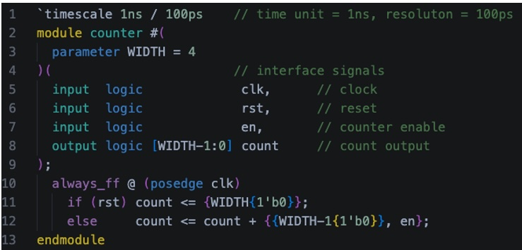
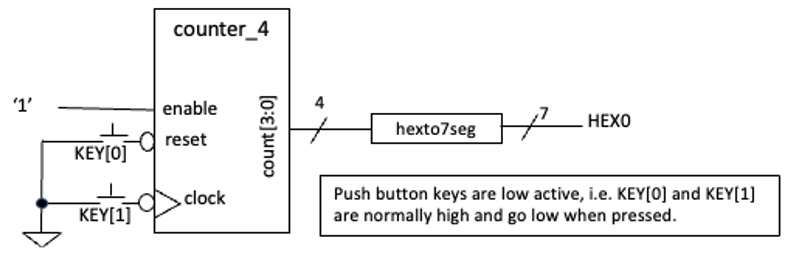
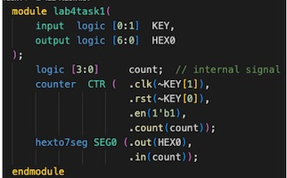
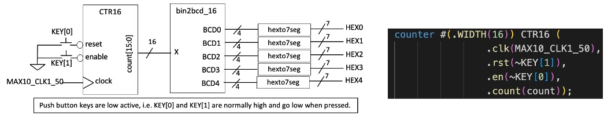
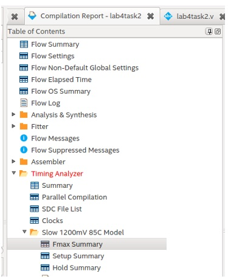
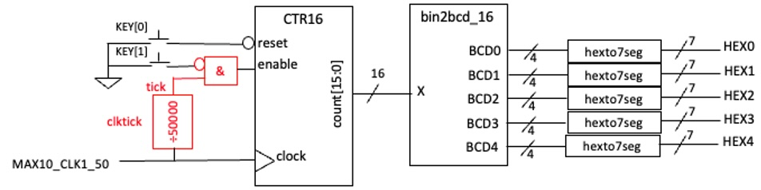
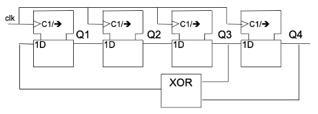

##### Department of Electrical & Electronic Engineering
##### Imperial College London

#### **ELEC50001 Circuits & Systems**

### **Lab 4 - Sequential circuits in SystemVerilog**
##### *Peter Cheung, v4.0 - 9 Nov 2026*

#### **Learning Outcomes**

Lab 4 teaches you:

* how to design different types of counters and timers;
* how to predict the maximum operating clock frequency of your clocked circuits;
* how to design some useful timing and counting components for later Laboratory Sessions;
* how to generate pseudo-random binary sequence using a linear feedback shift register.

#### **Reminder of Steps to create a design for DE10-Lite FPGA board**

1.	1.	Create a project using Project Wizard and name the project  **lab**X**task**Y.sv.  The top-level SystemVerilog file is  **lab**X**task**Y.sv.
2.	Specify the Device used as:  **10M50DAF484C7G**.
3.	Edit the Quartus Setting File (**_.qsf_**) and insert pin assignment file **_pin_assignment.txt_**.  
4.	Create or edit the different SystemVerilog specification files (**.sv**).
5.	Set top-level entity to be **_labXtaskY.sv_** with **Project -> Set Top-Level Entity**.
6.	Add other components (**.sv**) to the project with **Project -> Add/Remove Files …**.
7.	Specify timing constraints in design constraint file (**.sdc**) file (e.g. clock frequency) – not strictly required.
8.	Compile and synthesize the design.
9.	Program the DE10-Lite with the bit-stream file (**.sof**).

---
#### **Task 1: Testing a binary counter**
---
Download the solution: **_lab4task1_sol.sof_** (zipped) from the course webpage and see what you are trying to achieve.

#### **Step 1: Create the project for a 4-bit counter**

* Create in your work directory a folder named lab4 and in that, another folder task1.  

* Click file>New Project Wizard, and create project lab4task1 and top level file lab4task1.  Then click Finish.  (Quartus create a database structure in the folder: <home>/lab4/task1  with a project named lab4task1.

* Click File > New …  and select SystemVerilog as the new file.  An edit window will appear. Create the SystemVerilog file: “counter.sv” which contains a parameterizable binary counter in SystemVerilog as shown below.

<p align="center">  </p>

#### **Step 2: Enter the SystemVerilog specification of a binary counter**

* Enter the SystemVerilog module as shown above. This counter specification has a default bit width of 8 (i.e. 8-bit counter).  However, the counter will work for ANY number of bits by changing the parameter **WIDTH**.  Exactly how this works is explained in Lecture 6.

* The line **\`timescale 1ns / 100ps** tells the system to use 1 ns as the unit time step with a time resolution of 100ps. (Note first character is special – it is NOT the apostrophe ‘ but the ‘backwards apostrophe `.)

* Make sure that you fully understand this SystemVerilog code before proceeding to the next step.  Save the file as **_counter.sv_**.  (I recommend that you use module name as the file name to avoid confusion.)

#### **Step 3: Create the top-level design to test the counter**

* Create the top-level design file: **_lab4task1.sv_** that corresponds to the circuit shown below.  Note that the clock of the counter is driven by the momentary switch KEY[1] and the reset input to the counter is driven by KEY[0]. Both keys are LOW ACTIVE, meaning that the signal value is ‘0’ when the key is PRESSED.  (This is a good test to see that you can create a complete design and implement on the DE10 board.  Refer to the steps on page 1 to produce a working bit-stream file.)

<p align="center">  </p>

<p align="center">  </p>

>Why pressing the reset key does not reset the counter?  What else do you need to do to perform a reset?  What do you need to change in the counter.sv module so that the counter is reset to zero the moment that KEY[0] is pressed?

Now that you have verified your counter is working, add **_counter.sv_** to your **mylib** folder for future use.

---
#### **Task 2:  16-bit counter clocked by 50MHz system clock**
---

In this part of the experiment, you will implement a 16-bit counter and display its count value as a binary code decimal (BCD) number on the 7-segment displays.  You will also learn how to find the maximum clock frequency at which your design will work correctly.

**Step 1:**  Create a new project **lab4task2**, and make sure that you already have **_hexto7seg.sv_**, **_counter.sv_** and **_pin_assignment.txt_** stored in your **mylib** folder at your home folder for E2CAS. Download from the course webpage the component **_bin2bcd_16.sv_**, a module I have designed to convert a 16-bit binary number to 5 BCD digits. Make sure that this is stored in your **mylib** folder. This is the repository for all the common components/modules that you have designed and will be reused later.

**Step 2:**  **Selecting the FPGA** Device – Click **Assignments > Device….** and select the correct MAX10 FPGA: **10M50DAF484C7G**. 

**Step 3:** **Pin Assignment** – Open the **_lab4task2.qsf_** file (Quartus setting file).  Examine its content to make sure that the device and top-level entity is correctly specified. You will find that no pins are being assigned yet.  Insert into this file all the pin assignments information.  The easiest way to do this is to go the bottom of the file, click on: **Edit > Insert file ..**  then select **_\<home\>/mylib/pin_assignment.txt_** (you should have downloaded this file from the Experiment webpage and place this in mylib).  Note that you are currently not using all the pins assigned in the **_pin_assignment.txt_** file.  Don’t worry – all unused pins are ignored. This will produce a few more warning messages but full compilation can still go ahead without error.

**Step 4:** 	Create a top-level module **_lab4task2.sv_** in SystemVerilog to specify the circuit shown below.  You should be able to this if you have mastered Task 1 well, but with one exception.  The counter.sv module has a default bit-width of 4.  Now we need a 16-bit counter.  To make the counter 16-bit, one can instantiate the component with WIDTH parameter set to 16 as shown here:

<p align="center">  </p>

Go to the **_lab4task2.sv_** window and set this file as your top-level module.  Make sure that you include all the relevant SystemVerilog component for this design using the command:

```
    Project > Add/Remove Files in Project
```
and add **_counter.sv, hexto7seg.sv,_** and **_bin2bcd_16.sv_** from your library folder **_\<home\>/mylib/_**. 

**Step 5:**  Use  **Processing > Analyze Current File** check your newly created SystemVerilog files are error free. This is the quickest way to find the basic syntax errors in your Verilog code.  Once all the simple errors are fixed, use **Processing > Start Analysis** and **Elaboration** to perform fuller check of the **_lab4task2.sv_** to make sure that files are consistent and correct.  

**Step 6:**  Set clock frequency – Create a new file **_lab4task2.sdc_**  which should contain one single line:

```
 create_clock -name "MAX10_CLK1_50" -period 20.000ns [get_ports {MAX10_CLK1_50}]
```
>**NOTE:** Synopsis Delay Constraint (.sdc) files are standard formatted files introduced by Synopsis, a well-known company specializing on IC design CAD tools. With this, a designer can specify various timing constraints for the CAD tools the check against.  Here we are only using this to define clock frequency.

With this, Quartus will know that the signal MAX10_CLK1_50 is a 50 MHz clock signal.

**Step 7:** **Full Compilation** — Click:  Processing > Start Compilation.  This will go through the entire compilation process.  Examine the Tasks window on the left and see all the steps being taken to generate the final bit-stream.

**Step 8: Maximum clock frequency** – As part of the compilation process, **TimeQuest** timing analyzer is used to predict various timing information.  In the “Compilation Report” window, you should see a list of reports resulting from the compilation. Double-click **TimeQuest Timing Analyzer** entry, and you should see a list like the one shown here.  Clicking on various entries under this will show the various timing specifications.  Answer the following questions:

>What are the predicted maximum frequencies for this circuit under the highest and lowest temperatures?  What are the other interesting timing data that you can discover with these reports?  Why is the TimeQuest entry red, indicating that there may be a problem?  

<p align="center">  </p>

**Step 9:**	Test your design on the DE10 – program the DE10 and check that your design works.  

**Step 10:**  Examine the amount of FPGA resources being used by this 16-bit counter. Explain the results.

#### **Test-yourself Task – Cascade counter**

You are now required to create something yourself.  In the previous exercise, the 16-bit counter is counting with a 50MHz clock. This is much too fast for us to see the counter changing.  This part of the experiment requires you use the counter to count the number of millisecond elapsed.  You would need to do this by having two counters cascaded with each other (i.e. connected in series).  The overall block diagram is shown below.

The **_clktick.sv_** circuit generates a 1 cycle high pulse every 50,000 clock cycles.  Therefore, the output signal **_tick_** provides one enable pulse every 1 millisecond.  

>Exactly how **_clktick.sv_** module works will be covered in a later lecture.  

You can download this module from the course webpage and use it as a component for now.

Modify your circuit to implement this and test the new circuit on the DE10 board.

<p align="center">  </p>

---
#### **Task 3: Linear Feedback Shift Register (LFSR) and PRBS**
---

You would have encountered a 4-bit LFSR in Lecture 7, which implements the primitive polynomial:  $1+X^3+X^4$.   The circuit is given as:

<p align="center">  </p>

You are now required to implement a 7-bit LFSR implementing the polynomial:  $1+X^3+X^7$ ).    Assuming that you initialize z shift register to 7’d1, work out manually the first 10 sequence values of the output sequence. (The output sequence should be 127 long without repetition, is known as a **pseudo-random binary sequence** or **PRBS**.) 

Connect the shift register clock to KEY[1] and use the momentary key to cycle through the first 10 or 20 value of the PRBS sequence. The “random” output should be displayed as two hexadecimal digits.
